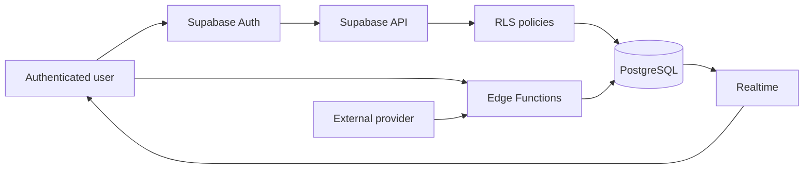

# Supabase Multi-Tenant B2B Demo

Production-oriented Supabase/Postgres multi-tenant demo with RLS, role-based authorization, Realtime and Edge Functions.

## Purpose

Reference architecture for a B2B SaaS where several companies share one database and must never see each other's data. Authorization lives in PostgreSQL, so no client (web, mobile, script) can bypass it.

## Stack

- Supabase CLI, local development with versioned migrations and seed
- PostgreSQL 17, Row Level Security
- Supabase Auth
- Edge Functions (Deno / TypeScript)
- Realtime (`postgres_changes`)
- Storage
- pgTAP tests, GitHub Actions

## Architecture



## Multi-Tenant Model

| Table | Purpose |
|-------|---------|
| `organizations` | Tenants |
| `organization_members` | User to organization link, with role and `active` flag. A user can belong to several organizations |
| `orders` | Tenant-owned business records |
| `order_events` | Append-only audit trail, filled by triggers. Feeds Realtime |
| `processed_webhooks` | Idempotency ledger for inbound webhooks |

Every tenant-owned row carries an explicit `organization_id`. The tenant is never taken from client input without being checked against the caller's memberships.

## Authorization Model

| Role | Read | Create | Update | Delete |
|------|------|--------|--------|--------|
| owner | yes | yes | yes | yes |
| operator | yes | yes | yes | no |
| viewer | yes | no | no | no |

Only `owner` manages memberships and renames the organization. Deactivating a membership (`active = false`) revokes access immediately.

## RLS Strategy

- RLS is enabled on every exposed table; `anon` has no table grants at all.
- Policies call two `security definer` helpers in a non-exposed `private` schema, `private.is_org_member` and `private.has_org_role`. They avoid recursive policy evaluation on `organization_members` and keep every policy one line long.
- Writes are restricted by column grants and a trigger: `organization_id` and `created_by` cannot be changed after insert, and inserts must set `created_by = auth.uid()`.
- Storage uses the same helpers, keyed on the first path segment.

Details in [docs/rls-model.md](docs/rls-model.md).

## Edge Functions

- `create-order`: validates the JWT and payload, then inserts using a client that carries the caller's token, so RLS still decides. No `service_role`.
- `external-webhook`: HMAC-SHA256 signature check with timestamp tolerance, then a single database call (`process_payment_webhook`) that records the event id and applies the change in one transaction. Replayed events are acknowledged and ignored.

## Realtime

`orders` and `order_events` are in the `supabase_realtime` publication. Realtime evaluates RLS per subscriber, so each user only receives changes from their own organizations. See [examples/realtime.ts](examples/realtime.ts).

## Storage

Private bucket `order-documents`, object path `{organization_id}/{order_id}/{filename}`. Read requires membership, write requires `owner` or `operator`, delete requires `owner`.

## Security Decisions

See [docs/security.md](docs/security.md).

## Local Setup

Requirements: Docker, Node.js 20+.

```bash
npm install
npx supabase start        # applies migrations and seed.sql
cp supabase/functions/.env.example supabase/functions/.env
npx supabase functions serve
```

Seed users (password `password123`):

| User | Organization | Role |
|------|--------------|------|
| alice@alpha.test | Alpha | owner |
| carlos@alpha.test | Alpha | operator |
| pedro@alpha.test | Alpha | viewer |
| laura@beta.test | Beta | owner |

Create an order:

```bash
curl -X POST http://127.0.0.1:54321/functions/v1/create-order \
  -H "Authorization: Bearer $ACCESS_TOKEN" \
  -H "Content-Type: application/json" \
  -d '{"organizationId":"0a000000-0000-0000-0000-000000000001","customerName":"Cliente Demo","amount":125000}'
```

## Running Tests

```bash
npm test
```

The suite checks, among other things, that a user from Alpha gets zero rows when querying a Beta order by its exact UUID, that a viewer cannot write, that anonymous access fails and that a deactivated member loses access. See [tests/README.md](tests/README.md).

## Production Considerations

- Keep `service_role` out of clients and out of the repository; only the webhook function uses it.
- Set `WEBHOOK_SECRET` with `supabase secrets set` and rotate it periodically.
- Add a reconciliation job for webhook events that never arrive.
- Prune `processed_webhooks` after the provider's retry window.
- Index additions should follow real query plans; the ones here cover the access paths used by the policies.
- Run migrations through CI against a staging project before production.

## Relationship to real-world experience

This repository contains no source code, customer data or proprietary assets from production systems. It is a standalone reference implementation that demonstrates architectural patterns I have worked with in B2B SaaS systems, including multi-tenant isolation, role-based authorization, PostgreSQL and backend integrations.
